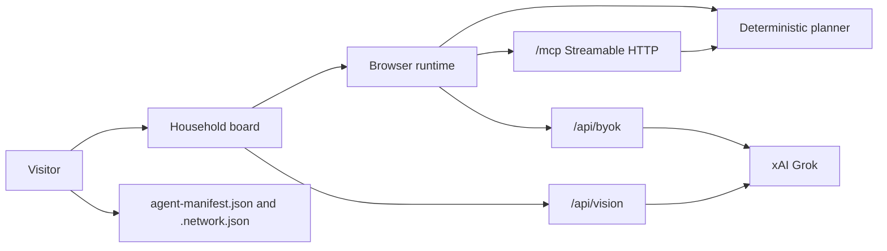

# Architecture

Hearth is a Next.js site. The household board, the agent loop, and the deterministic planner run in the browser. A small server exists for three things the browser cannot safely do alone: a public MCP endpoint, an optional publisher-funded vision call, and a same-origin BYOK proxy for routers that do not send CORS headers.

## Published network

`agent-manifest.json` names two networks.

- `hearth`, front agent `household_coordinator`, definition `hearth.network.json`. It delegates to `dinner_planner`, `errand_scheduler`, and the peer network `pantry_watch`.
- `pantry_watch`, front agent `pantry_sentinel`, definition `pantry_watch.network.json`.

`links.json` binds the name `pantry_watch` to `/pantry_watch`. A caller resolves that URL by loading `agent-manifest.json` from the site base and selecting the network with that exact name. The runtime refuses a miss, a composition cycle, an over-budget call, and a denied origin.

Private context is deny-by-default. The coordinator may forward `sessionId` downstream. A BYOK key is never placed in the network, the prompt, the peer request, or a tool argument.

## Planner

`src/lib/planner.ts` is pure. `plan_dinner` keeps a recipe only when every person's constraint allows it, prefers food that expires within two days, and returns the ingredients whose quantity is still short after taking the max of the pantry and the fridge read. Chicken and mushrooms on the shelf are reported as skipped, not cooked. `build_shopping_list` adds low staples and holds any line that would pass the weekly budget. `schedule_errands` walks the next three days and skips windows that overlap a busy block.

## Autonomy

`noticeNeeds` proposes at most a dinner card and a restock card. It does not mutate the household. `applyProposal` writes the meal, the shopping lines, and the errand, then checks that the board matches the proposal. The receipt says no order was placed. A verified receipt for the same proposal is not applied twice. A write that times out is marked unknown and is not retried.

## Inference

With no key, the runtime is the deterministic planner. That is the site's default router, so the host does not pay for a model call. With a key, the browser posts to `/api/byok/chat`. The route forwards the visitor's `Authorization` header and the router URL they chose. If the model errors or times out, the runtime falls back to the deterministic planner and records the fallback.

Fridge photos use `/api/vision` when `XAI_API_KEY` is set, or `/api/byok/vision` when the visitor saved a key. The visitor route will not read the server key.

## MCP and WebMCP

`POST /mcp` is a stateless Streamable HTTP server. `tools/call` runs the same planner functions. If the browser cannot reach MCP, the runtime uses the in-browser tool and says so in the trace. When `navigator.modelContext` exists, the page registers the same four tools for WebMCP.

## Self-healing

`resilient` in `src/lib/healing.ts` applies a timeout, a retry budget, an optional fallback, and a verifier. Side-effecting work that times out or fails verification is reported as unknown and is not repeated. The House status panel runs the planner, MCP, the manifest, vision configuration, and the four fail-closed guards, and it shows the last receipt.
